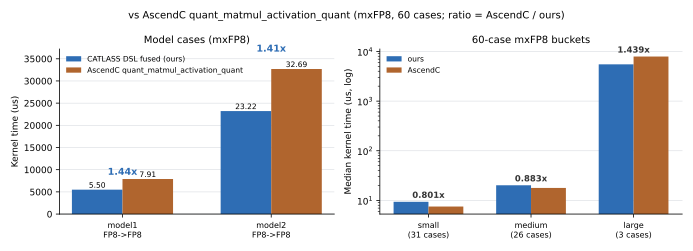

# QbmmSwiGluMxQuant Example Readme

## 功能说明

- 算子功能：将 MX 量化矩阵乘（QuantBatchMatmulV3）、SwiGLU 激活与 Dynamic MX 量化融合为一个 CATLASS DSL AIC/AIV mixed kernel。Cube 侧完成 MXFP8 / MXFP4 矩阵乘与 FP32 累加，Vector 侧直接对 FP32 累加结果做 SwiGLU、BF16 舍入与 32 元素分组的 Dynamic MX 量化，激活中间结果不落 GM。
- 计算公式：记 $A$ 为 `[M, K]`、$B$ 为 `[K, N]`，$s^{A}$、$s^{B}$ 为对应的 E8M0 分块缩放因子（每 32 个元素一个）：

  $$
  \begin{aligned}
  C_{i,j} &= \sum_{k} \left(A_{i,k}\, s^{A}_{i,\lfloor k/32 \rfloor}\right)
             \left(B_{k,j}\, s^{B}_{\lfloor k/32 \rfloor,j}\right) \\
  S_{i,j} &= \operatorname{silu}(C_{i,j}) \cdot C_{i,\,j+N/2}, \qquad j < N/2 \\
  S^{16} &= \operatorname{round\_bf16\_rne}(S) \\
  (Y, S^{Y}) &= \operatorname{dynamic\_mx\_quant}(S^{16})
  \end{aligned}
  $$

  $C$ 为 FP32 累加结果，SwiGLU 在 FP32 上计算，量化输入舍入为 BF16；$Y$ 与 $S^{Y}$ 按 32 元素分组共享 E8M0 指数，输出格式由 `out_fp4` 选择 MXFP8 或 MXFP4。

- 支持产品型号：Ascend 950PR&950DT系列产品

## 参数说明

```python
y, scale_y = qbmm_swiglu_mxquant.run(a, scale_a, b, scale_b, in_fp4, out_fp4)
```

所有张量均为 byte tensor：FP8 字节为 E4M3FN，FP4 字节为沿 K 打包的 E2M1（第 $2i$ 个元素在低 4 位、第 $2i+1$ 个元素在高 4 位）。

| 参数 | 属性 | shape | dtype | 说明 |
| ----- | ----- | ----- | ----- | ----- |
| `a` | Input | `[M, K]`（`in_fp4=0`）或 `[M, K/2]`（`in_fp4=1`） | `uint8` | 左操作数，行优先 |
| `scale_a` | Input | `[M, K/64, 2]` | `uint8` | 左操作数 E8M0 缩放因子，逻辑 shape 为 `[M, K/32]` |
| `b` | Input | `[K, N]`（`in_fp4=0`）或 `[N, K/2]`（`in_fp4=1`） | `uint8` | 右操作数；FP8 为行优先，FP4 为逻辑 `[K, N]` 列主序打包 |
| `scale_b` | Input | `[K/64, N, 2]` | `uint8` | 右操作数 E8M0 缩放因子，逻辑 shape 为 `[K/32, N]` |
| `in_fp4` | Input | 标量 | `int` | `0` 表示输入 MXFP8，`1` 表示输入 MXFP4 |
| `out_fp4` | Input | 标量 | `int` | `0` 表示输出 MXFP8，`1` 表示输出 MXFP4 |
| `y` | Output | `[M, N/2]`（`out_fp4=0`）或 `[M, N/4]`（`out_fp4=1`） | `uint8` | 量化后的激活结果 |
| `scale_y` | Output | `[M, N/64, 2]` | `uint8` | 激活结果的 E8M0 缩放因子，逻辑 shape 为 `[M, N/32]` |

## 约束说明

| 项目 | 约束 |
| ----- | -------- |
| 维度 | `M`、`K`、`N` 为正整数；`K % 64 == 0`，`N % 64 == 0` |
| dtype | 所有输入、输出均为 `uint8`；`in_fp4` / `out_fp4` 为 Python `int` 标量 |
| 布局 | `a` 行优先；`b` 在 FP8 模式下为行优先，FP4 模式下为逻辑 `[K, N]` 列主序打包 |
| 设备 | 所有张量位于同一 NPU |
| 尾块 | `M`、`N` 无需按 tile 对齐，kernel 只拷贝有效 extent；`K` 尾块在片内补零；E8M0 缩放因子的 K 组数在 host 侧补齐为 127（中性值 1.0） |
| 数值 | 缩放因子按 32 元素分组共享；SwiGLU 左半为 silu 分支、右半为门控分支；输出 scale 组按 `N/64` 对齐 |

## 使用示例

准备好 CANN、PyTorch、torch_npu 与 catlass DSL 环境，在 CATLASS 仓库根目录导入样例模块后调用 `run`。脚本根据 shape 与输入输出格式编译 kernel、执行 NPU 计算并返回激活量化结果及其缩放因子：

```python
import torch
import torch_npu  # noqa: F401

import qbmm_swiglu_mxquant

m, k, n = 128, 512, 1024
a = torch.randint(0, 127, (m, k), dtype=torch.uint8, device="npu:0")
scale_a = torch.full((m, k // 64, 2), 127, dtype=torch.uint8, device="npu:0")
b = torch.randint(0, 127, (k, n), dtype=torch.uint8, device="npu:0")
scale_b = torch.full((k // 64, n, 2), 127, dtype=torch.uint8, device="npu:0")

y, scale_y = qbmm_swiglu_mxquant.run(a, scale_a, b, scale_b, in_fp4=0, out_fp4=0)
print(y.shape, scale_y.shape, y.dtype, scale_y.dtype)
```

执行结果如下，说明样例执行成功：

```text
torch.Size([128, 512]) torch.Size([128, 16, 2]) torch.uint8 torch.uint8
```

## 同步实现

核内流水同步使用 `tla.mutex`：L1 stage0/1、L0 stage0/1、L0C、输出 UB 各一个二元 mutex，
生产者（MTE2 / MTE1 / CUBE / VECTOR）在对应 pipe 上 `lock`/`unlock` 包住写入，消费者
（MTE1 / CUBE / FIX / MTE3）在对应 pipe 上 `lock`/`unlock` 包住读取。AIC↔AIV 的
`ub_ready` / `ub_free` 属于跨核同步，仍使用 `tla.cross_flag`。

## 性能数据

测量环境：Ascend950DT（DAV_3510）、CANN 9.2.0。设备时间取 `torch_npu.profiler`
`kernel_details`（warmup=5，active 步中位数），不含 host 侧 Python/ACLNN 间隙。对比对象为
AscendC 实现 `quant_matmul_activation_quant`（ops-nn，mxFP8 输入/输出；激活语义与本算子
一致：FP32 累加结果直接做 SwiGLU，量化前舍入 BF16）。

### 与 AscendC quant_matmul_activation_quant 的性能对比（mxFP8，60 例）



| 指标 | 本实现 | AscendC quant_matmul_activation_quant |
| --- | ---: | ---: |
| 精度通过 | 60/60 | 60/60 |
| cross y / scale 匹配率 | **1.0 / 1.0** | — |
| model1 FP8→FP8（13640×5376×28672） | 5495.0 us | 7906.1 us（**1.439x**） |
| model2 FP8→FP8（56240×5376×28672） | 23216.9 us | 32691.8 us（**1.408x**） |
| small 中位（31 例） | 9.38 us | 7.52 us（0.801x） |
| medium 中位（26 例） | 20.16 us | 17.80 us（0.883x） |
| large 中位（3 例） | 5495.0 us | 7906.1 us（**1.439x**） |
| 全体中位（60 例） | 13.16 us | 12.72 us（0.966x） |

- 两个模型形状平均 **1.423x**；60 例中 **18 例快于 AscendC 实现**（10 例 ≥1.1x）。
- small/medium 仍落后，差距来自固定 tiling 与 launch 开销；large 与两个模型形状领先。
- 精度：cross y/scale 匹配率均为 1.0，60/60 通过（融合语义，FP32 激活）。
